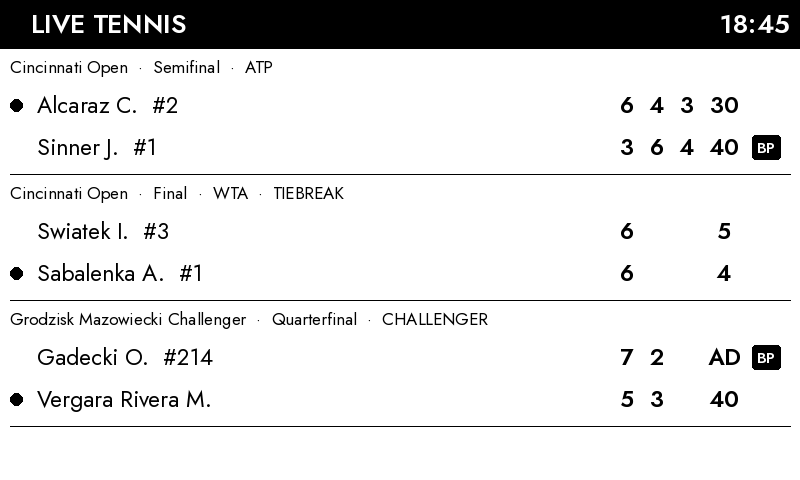
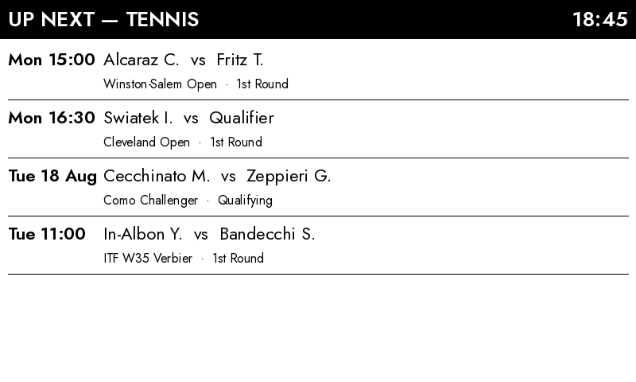

# InkyPi Live Tennis

An [InkyPi](https://github.com/fatihak/InkyPi) plugin that turns your e-ink display into a live tennis scoreboard — matches in play right now with per-set games, in-game points, the serving player and derived break-point markers, falling back to the upcoming schedule when nothing is live.

## Screenshots

Live matches (players + rankings, per-set games, current points, serving dot ●, and a **BP** badge on the row of the player holding a break point):



When no matches are live, the next scheduled fixtures:



Rendering is pure black-on-white Pillow — no grays, no images — so it stays crisp on any e-ink panel and any palette.

## Features

- Live matches across all tours (ATP, WTA, Challenger, ITF, juniors), with player rankings where known
- Per-set games, current in-game points, serving dot, tiebreak flag
- Break points derived from the score itself (receiver holds AD, or receiver at 40 with the server below 40 — never flagged in a tiebreak)
- Optional tour filter and player filter (comma-separated name substrings)
- Automatic fallback to the upcoming fixtures list when nothing is live
- Scales to any display size and orientation (tested from Inky pHAT 250×122 up)

## Installation

Install with the InkyPi CLI (plugin id first, then the repository URL):

```bash
inkypi plugin install live_tennis https://github.com/livetennisapi/inkypi-live-tennis
```

On older InkyPi installations the command is `inkypi-plugin install live_tennis https://github.com/livetennisapi/inkypi-live-tennis`.

Then open the InkyPi web UI, pick the **Live Tennis** plugin, paste your API key and add it to a playlist.

## API dependency, key and free-tier limits

This plugin depends on the [Live Tennis API](https://livetennisapi.com) ([docs](https://docs.livetennisapi.com)).

- **Get a free key:** <https://livetennisapi.com/subscribe/free> — self-serve, no card required.
- **Free tier limits:** 100 requests/day and 30 requests/minute. The free tier covers everything this plugin uses: live matches (`GET /matches?status=live`) and upcoming fixtures (`GET /fixtures`). Historical results, market prices and model fields are paid tiers and are **not** used by this plugin.
- Paste the key into the plugin settings (stored per plugin instance), or put it in InkyPi's `.env` file instead:

  ```
  LIVE_TENNIS_API_KEY=your-key
  ```

### Refresh interval and the daily quota

The plugin **never calls the API more often than once per 15 minutes**, no matter how frequently InkyPi refreshes it — in between it re-renders from a local cache. At the 15-minute floor that is ≈96 live polls/day, inside the free 100/day; the fixtures fallback is cached for 6 hours so quiet days stay within quota too. Set your playlist refresh interval to **15 minutes or longer** (a shorter interval just redraws cached data). Polling faster than that — or anything historical — needs a paid tier.

## Settings

| Setting | Meaning |
|---|---|
| API Key | Your Live Tennis API key (password field). Falls back to `LIVE_TENNIS_API_KEY` in `.env` if empty. |
| Tour | All tours, or one of ATP / WTA / Challenger / ITF / Juniors. |
| Player filter | Optional comma-separated names (substring match, e.g. `Alcaraz, Sabalenka`). Applies to both live matches and fixtures. |

## Development

Pure-logic parsing/derivation and rendering are importable without an InkyPi installation:

```bash
pip install pillow requests pytest
pytest tests/                      # break-point derivation + payload parsing + render smoke tests
python tests/render_samples.py     # regenerates the screenshots from sample payloads (no network)
```

## Status

Actively maintained — by the team behind the Live Tennis API itself.

## License

MIT — see [LICENSE](./LICENSE).
